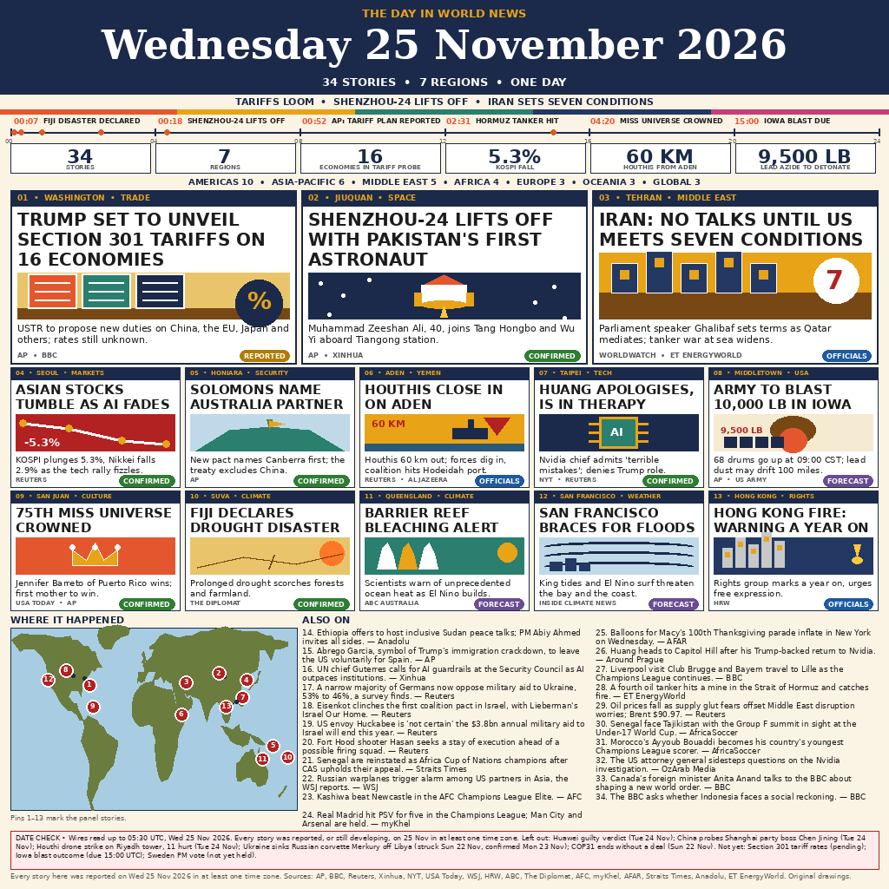

# Wednesday 25 November 2026 — The Day in World News

[](https://make.fun/competitions/news-image-20261125)
[](https://make.fun/competitions/news-image-20261125)
[](https://make.fun/competitions/news-image-20261125)

One image summing up 25 November 2026's world news: 34 stories across
7 regions — Section 301 tariffs loom over 16 economies, Shenzhou-24 lifts
off with Pakistan's first astronaut, and Iran sets seven conditions for
talks — plus a UTC timeline, a world map with 13 numbered pins, and a
DATE CHECK box separating what happened on 25 Nov from what did not.

## How it works

`draw.py` (Pillow, run on the build machine) draws the 1024×1024 front
page as flat 2D vector art and writes `entry.png`. `main.py` is standard
library only: it copies `entry.png` to `$MAKEFUN_OUTPUT_DIR`, so both
grader runs produce byte-identical output.

## Build

```sh
python3 draw.py   # writes entry.png (1024x1024, <= 1 MiB)
python3 main.py   # copies entry.png to ./out/entry.png
```

## Entry



Original drawings. Every story was reported on Wed 25 Nov 2026 in at
least one time zone; see the DATE CHECK box on the page for what was left
out and what had not happened yet.
